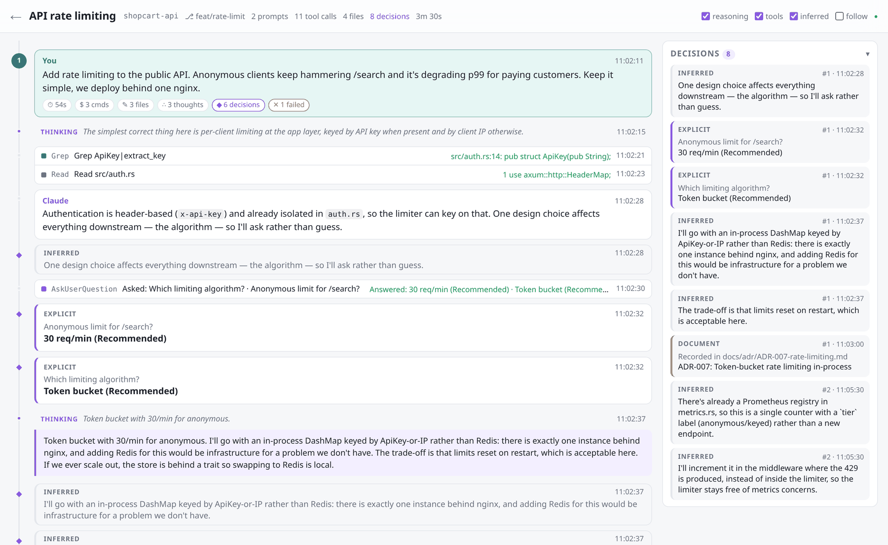

<h1 align="center">claude-progress</h1>

<p align="center">
  A live, readable window into your <a href="https://claude.com/claude-code">Claude Code</a> sessions —<br>
  what you asked, what Claude was thinking, what it did, and the decisions made along the way.
</p>

<p align="center">
  <a href="LICENSE"></a>
  
  
  <a href="https://buymeacoffee.com/buengenio"></a>
</p>

<picture>
  <source media="(prefers-color-scheme: dark)" srcset="docs/screenshot-dark.png">
  
</picture>

## Why

Claude Code's chat is great for *driving* the work and poor for *following* it: reasoning scrolls past, tool
output buries the narrative, and the choices that shaped the code end up spread across an hour of transcript.

`claude-progress` reads the transcripts Claude Code already writes (`~/.claude/projects/**/*.jsonl`), tails
them, and serves a page you keep open **next to the chat** — in a browser tab or a VS Code split. Nothing is
hooked into the chat, nothing leaves your machine.

## What you see

| | Where it comes from |
|---|---|
| **Prompts**, numbered, with chips for duration · commands run · files touched · decisions · failures | your messages |
| **Thinking**, one line each, click to expand | Claude's reasoning blocks |
| **Replies** rendered as markdown | Claude's text |
| **Steps** — consecutive tool calls grouped, with each outcome inline (green/red) | `tool_use` + `tool_result` |
| **Decisions** panel, sticky on desktop, collapsible on phones | **explicit** — answers you gave to `AskUserQuestion` · **document** — an ADR / `DECISIONS.md` being written (also via heredoc) · **inferred** — sentences in reasoning that read like a choice (*"go with"*, *"instead of"*, *"trade-off"*, …) |

Header toggles hide reasoning, tool steps or inferred decisions; **follow** auto-scrolls as new activity arrives.
The page updates live over SSE and resumes cleanly after a reconnect. Light and dark themes follow the OS.

## Install

Requires Rust 1.85 or newer ([rustup](https://rustup.rs)).

```sh
cargo install --git https://github.com/BuenGenio/claude-progress
claude-progress --open          # http://127.0.0.1:7331/latest
```

Or from a clone:

```sh
git clone https://github.com/BuenGenio/claude-progress && cd claude-progress
cargo run --release -- --open
```

Templates and assets are compiled into the binary, so the installed command works from any directory.

### Next to the chat

* **Browser** — open `http://127.0.0.1:7331/latest` in a narrow window beside your terminal or editor.
* **VS Code** — `Ctrl/⌘+Shift+P` → **Simple Browser: Show** → paste the URL → drag the tab into a split.
  No extension needed.

### Keep it running (Linux, systemd user service)

```ini
# ~/.config/systemd/user/claude-progress.service
[Unit]
Description=claude-progress

[Service]
ExecStart=%h/.cargo/bin/claude-progress
Restart=on-failure

[Install]
WantedBy=default.target
```

```sh
systemctl --user enable --now claude-progress
```

## Usage

```
claude-progress [OPTIONS]

  --port <PORT>            Port to listen on, always bound to 127.0.0.1     [default: 7331]
  --projects-dir <DIR>     Transcript root                                   [default: ~/.claude/projects]
  --poll-ms <MS>           How often open sessions are checked for new lines [default: 750]
  --open                   Open the most recent session in the browser
  --templates <DIR>        Use these templates instead of the built-in ones (hot-reloaded)
  --static <DIR>           Use this static dir instead of the built-in one
  --dump-assets <DIR>      Write the built-in templates/ and static/ into DIR, then exit
```

| Route | |
|---|---|
| `/` | all sessions, grouped by project, newest first, live ones marked |
| `/latest` | redirects to the most recently active session |
| `/s/<id>` | a session |
| `/s/<id>/events` | SSE stream of new activity (honours `Last-Event-ID`) |

## Make it look the way you want

The page is plain HTML rendered from Jinja-style templates ([minijinja](https://github.com/mitsuhiko/minijinja)),
one CSS file with design tokens on `:root`, and a small script that applies live fragments. Get a copy, edit,
refresh — templates hot-reload, no rebuild:

```sh
claude-progress --dump-assets ~/.config/claude-progress
claude-progress --templates ~/.config/claude-progress/templates --static ~/.config/claude-progress/static
```

```
templates/
  base.html · index.html · session.html
  partials/
    block.html            dispatches on kind → prompt | narrative | reasoning | step | decision
    prompt.html · narrative.html · reasoning.html · step.html · tool.html · result.html
    decision.html         inline decision card
    decision_panel.html   entry in the right-hand panel
    chips.html            per-prompt stats · header_stats.html session stats
static/app.css            tokens, light/dark, layout
static/app.js             applies SSE fragments (kinds: block, tool, tool_result, decision, stats)
```

The same partials render the initial page and the fragments pushed over SSE, so one edit covers both.
Running from a clone, `./templates` and `./static` are picked up automatically.

## How it works

```
~/.claude/projects/**.jsonl ──tail──▶ reducer ──▶ events ──▶ templates ──▶ HTML page + SSE fragments
                                   src/model.rs     Vec     templates/
```

* **`src/store.rs`** — indexes sessions cheaply (reads only the first and last 96 KB of each file for the
  project path, first prompt and AI title), fully parses a session the first time it is opened, then polls it
  for appended bytes. An 80 MB transcript opens in about a second.
* **`src/model.rs`** — folds records into `Prompt`, `Reasoning`, `Narrative`, `StepOpen` / `Tool` /
  `ToolResult` and `Decision` events; computes per-prompt and per-session stats.
* **`src/tools.rs`** — one-line summaries per tool and the files each call wrote, including `>` / `tee`
  targets in shell commands (heredoc bodies and `->` arrows excluded).
* **`src/text.rs`** — strips harness noise from prompts, renders markdown with raw HTML escaped, and holds the
  sentence heuristics behind *inferred* decisions.
* **`src/main.rs`** — axum routes and the SSE endpoint.

The transcript format is undocumented and changes; unknown record types are ignored and malformed lines are
counted rather than fatal. Subagent transcripts (`<session>/subagents/*.jsonl`) are not rendered yet — the
parent session shows the `Agent` delegation.

**Privacy:** the server binds `127.0.0.1` only, reads transcripts read-only, and makes no network requests.

## Contributing

Issues and pull requests are welcome — this started as a one-evening tool and there is plenty of room to grow.

**Set up**

```sh
git clone https://github.com/BuenGenio/claude-progress && cd claude-progress
cargo run -- --projects-dir fixtures/demo --open      # a small synthetic session, no real transcripts needed
```

`fixtures/demo` contains a hand-written session that exercises every event type (prompts, thinking, grouped
tools, a failed command, an `AskUserQuestion`, an ADR written via heredoc). Point `--projects-dir` at your real
`~/.claude/projects` to test against the wild.

**Before you open a PR**

```sh
cargo fmt --check
cargo clippy --all-targets -- -D warnings
cargo test
```

* Keep PRs focused; UI changes should include a before/after screenshot (light and dark).
* New template or static files must also be listed in `src/assets.rs` so the installed binary ships them.
* The transcript format is reverse-engineered — if a record shape surprises the parser, a redacted sample line
  in the issue makes fixes quick.

**Ideas that would be great to have**

* Render subagent transcripts nested under their `Agent` call.
* Optional LLM pass (`claude -p`) to turn each prompt's work into a two-sentence summary and to promote
  inferred decisions to real ones.
* Search / filter across sessions ("where did we decide on the auth scheme?").
* Export a session to Markdown — a ready-made engineering log.
* Push-based updates from Claude Code hooks instead of polling.
* Packages: Homebrew, AUR, `cargo binstall`.

## Support

If this saves you scroll-time, you can [buy me a coffee](https://buymeacoffee.com/buengenio) ☕ — it keeps
the side projects going.

<a href="https://buymeacoffee.com/buengenio"></a>

## License

[MIT](LICENSE) © 2026 Eugene Trotsan
